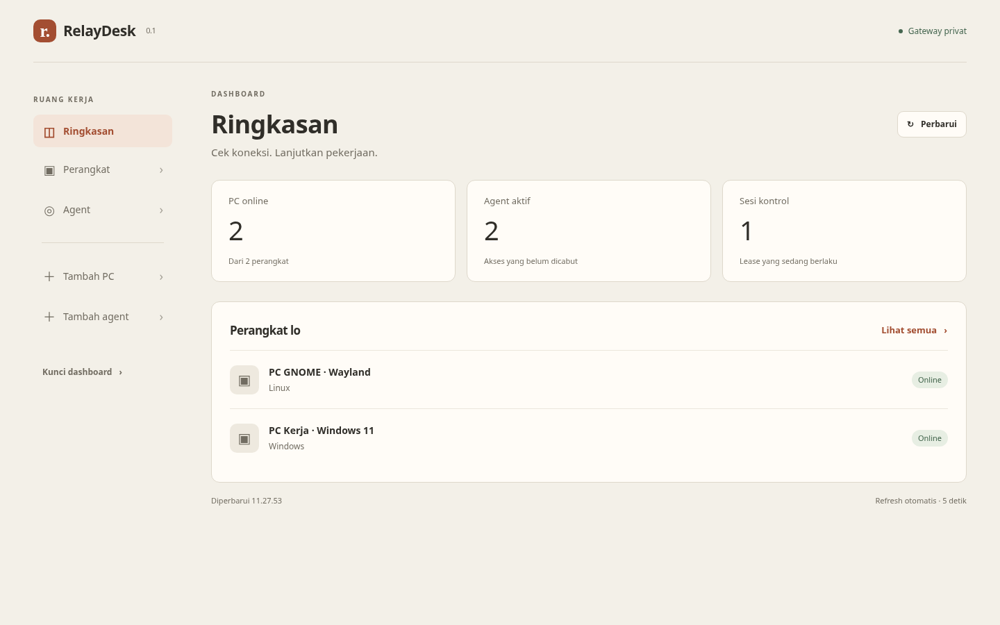
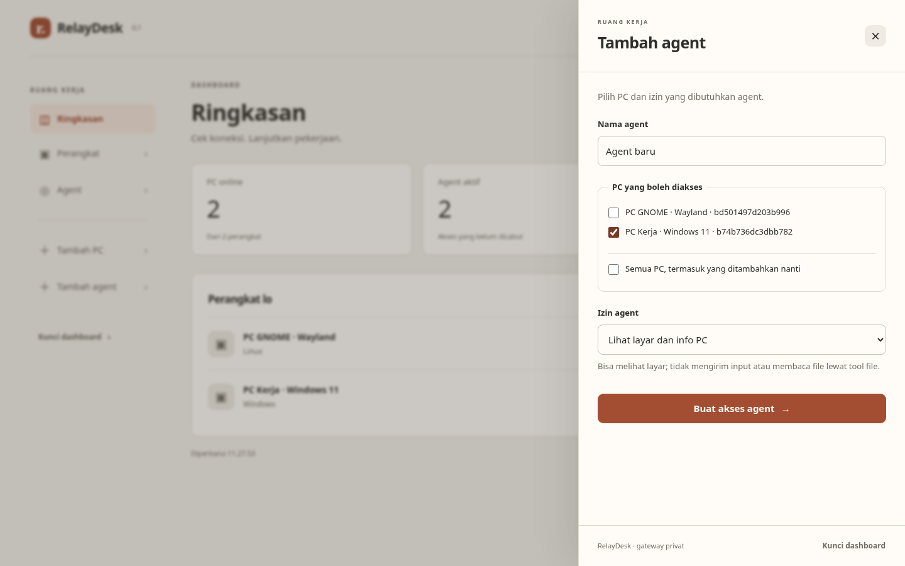
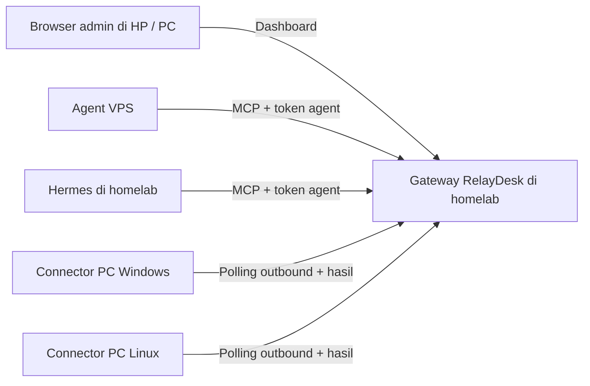

# RelayDesk

RelayDesk menghubungkan agent AI yang sudah lo punya ke PC Windows/Linux melalui satu gateway MCP di homelab. Agent bisa memakai tool untuk mengambil screenshot, mengirim input desktop, menjalankan perintah, dan mengelola file sesuai izin yang diberikan.

**Pasang connector di setiap PC tujuan, bukan model atau agent AI baru.** Agent VPS dan Hermes tetap berjalan di host masing-masing. Jaringan WireGuard/MikroTik CHR yang sudah ada tetap dipakai.

> **Status 0.1: masih tahap pengembangan.** Dashboard web sudah tersedia, tetapi aplikasi connector PC masih wizard console. **Kontrol GUI GNOME Wayland belum tersedia**; shell dan file tetap bisa digunakan. Backend Windows sudah dibuat dan binary berhasil dibangun, tetapi belum diuji langsung pada Windows Server/10/11. Baca [status verifikasi](docs/STATUS.md) sebelum menggunakan pada desktop penting.

**Lisensi proprietary:** publikasi source tidak memberi izin umum untuk memakai, memodifikasi, menjual, mendistribusikan ulang atau melakukan rebrand. Penggunaan di luar hak yang sudah berlaku memerlukan izin tertulis pemegang hak cipta. Lihat [LICENSE](LICENSE), [NOTICE](NOTICE), [komponen pihak ketiga](THIRD_PARTY_NOTICES.md), dan [batas perlindungan merek](docs/BRAND_PROTECTION.md). Panduan build/instalasi berikut ditujukan kepada pemilik dan pengguna yang mendapat izin.

## Daftar isi

- [Tampilan dashboard](#tampilan-dashboard)
- [Arsitektur dan kebutuhan](#arsitektur-dan-kebutuhan)
- [Dukungan saat ini](#dukungan-saat-ini)
- [1. Ambil source dan build](#1-ambil-source-dan-build)
- [2. Jalankan gateway](#2-jalankan-gateway)
- [3. Pairing PC](#3-pairing-pc)
- [4. Hubungkan agent](#4-hubungkan-agent)
- [5. Alur kerja agent](#5-alur-kerja-agent)
- [CLI dan konfigurasi](#cli-dan-konfigurasi)
- [Operasi harian dan uninstall](#operasi-harian-dan-uninstall)
- [Data, izin, dan keamanan](#data-izin-dan-keamanan)
- [Troubleshooting](#troubleshooting)
- [Pengujian](#pengujian)
- [Roadmap dan struktur source](#roadmap-dan-struktur-source)

## Tampilan dashboard

Dashboard memakai halaman ringkasan, latar krem, dan aksen terracotta. Menu **Perangkat**, **Agent**, **Tambah PC**, dan **Tambah agent** membuka slide drawer dari kanan. Form tidak memenuhi halaman utama.



<details>
<summary>Lihat drawer dan tampilan HP</summary>



[Tampilan HP](docs/images/mobile.png)

</details>

Screenshot berasal dari aplikasi yang berjalan dengan **data contoh**. Nama PC, agent, dan status Online di screenshot bukan bukti koneksi ke host pengguna atau dukungan GUI Wayland.

Drawer dapat ditutup dengan ×, Escape, atau klik di luar panel. Draft form dipertahankan; **kode/token hasil dihapus ketika panel hasil ditutup**, jadi salin dahulu. Selama permintaan perubahan berjalan, tunggu selesai atau gunakan **Kunci dashboard** untuk keluar. Kunci membersihkan kredensial dari tab; tidak mencabut akses agent atau menghentikan connector di PC.

## Arsitektur dan kebutuhan



Seluruh koneksi di atas melewati jaringan privat yang sudah tersedia. Gateway menyimpan identitas perangkat, izin, lease kontrol, dan antrean pekerjaan. Connector menjalankan pekerjaan sebagai user desktop yang meluncurkannya. Agent tetap bertanggung jawab merencanakan tindakan dan membaca hasil.

| Komponen | Dipasang di mana | Kebutuhan |
| --- | --- | --- |
| Gateway | Homelab/server privat | Docker + Compose, atau binary native; port TCP 8787 dapat dijangkau client |
| Dashboard | Browser HP/PC | Browser modern dengan JavaScript; URL gateway dan admin token |
| Connector | Setiap PC tujuan | Windows x64 atau Linux amd64; untuk GUI, user login pada sesi desktop aktif |
| Agent | VPS dan homelab yang sudah ada | Host agent mendukung MCP Streamable HTTP atau MCP stdio |
| Build | Mesin pengembangan Linux | Git, Go 1.24+, `dpkg-deb` untuk paket DEB |

Agent tidak perlu plugin remote desktop terpisah jika host agent sudah mendukung MCP RelayDesk. Host yang hanya mendukung stdio dapat memakai bridge binary. RelayDesk tidak memasang atau mengonfigurasi integrasi MCP Hermes secara otomatis; konfigurasi dua agent asli belum diuji langsung.

## Dukungan saat ini

| Area | Tersedia | Batas penting |
| --- | --- | --- |
| Dashboard web | Pairing, daftar PC/agent, izin tool, revoke, ringkasan lease, drawer desktop/HP | Mengelola akses; bukan viewer video remote desktop |
| MCP | 15 tool, HTTP dan bridge stdio, cancellation | Telah diuji dengan SDK resmi lokal; belum dengan dua agent asli |
| Linux X11 | Screenshot, mouse, keyboard/Unicode, browser, shell, file | GUI diuji di Xvfb + Tk; desktop fisik/multimonitor belum diuji |
| GNOME Wayland | Shell dan file | **Screenshot/input GUI belum diimplementasikan** |
| Windows interaktif | Source backend PowerShell/.NET, binary x64 | Belum diuji pada Windows asli; jangan anggap dukungan semua aplikasi sudah tervalidasi |
| Instalasi Linux | DEB, icon/menu desktop, autostart setelah pairing | Install/remove diuji terisolasi; login/autostart desktop nyata belum diuji |
| Instalasi Windows | EXE portable dan script pemasangan per-user | Bukan installer GUI EXE/MSI bertanda tangan; script belum diuji pada Windows |
| Kontrol lokal | Ctrl+C atau tutup window connector | Pause/Stop GUI, hotkey dan takeover otomatis belum tersedia |
| Sesi terkunci/UAC/RDP disconnected | Belum didukung | Fokus saat ini desktop aktif ketika user bekerja; prompt UAC disetujui lokal |

PC Online hanya berarti connector baru menghubungi gateway, bukan jaminan capture/input siap. Lihat kemampuan perangkat dan hasil tool. Tidak ada Wake-on-LAN, auto-login, video streaming, PTY interaktif atau integrasi DOM/CDP pada versi ini.

## 1. Ambil source dan build

Jalankan pada mesin build Linux. Binary hasil build dapat disalin ke PC tujuan; Go tidak perlu dipasang pada setiap PC.

```sh
git clone https://github.com/firefuck/connector-for-agent.git
cd connector-for-agent

go version          # harus Go 1.24 atau lebih baru
dpkg-deb --version   # bagian paket dpkg pada Debian/Ubuntu
sh packaging/build.sh
```

Folder `dist/` merupakan **hasil build lokal dan tidak disimpan di Git**. Setelah clone, file EXE/DEB belum ada sampai build selesai.

| Hasil build | Fungsi |
| --- | --- |
| `dist/relaydesk-linux-amd64` | Binary Linux: gateway, connector, admin CLI, MCP bridge |
| `dist/relaydesk.exe` | Binary Windows x64: wizard console dan CLI |
| `dist/relaydesk_0.1.0_amd64.deb` | Paket Debian/Ubuntu amd64 beserta integrasi desktop |
| `dist/LICENSE`, `dist/NOTICE`, `dist/THIRD_PARTY_NOTICES.md` | Pemberitahuan yang harus menyertai binary portable |
| `dist/SHA256SUMS` | Checksum hasil build; bukan tanda tangan digital |

Verifikasi file hasil build dari direktori `dist` dengan `sha256sum -c SHA256SUMS`. Manifest ini tidak ditandatangani; ia mendeteksi perubahan file relatif terhadap manifest, bukan membuktikan siapa penerbitnya. Jangan mempercayai manifest dari sumber yang tidak dipercaya.

Periksa lisensi yang tertanam di binary dengan `./dist/relaydesk-linux-amd64 license`. Build gagal bila pemeriksaan konsistensi branding/notices/paket gagal.

Jika hanya membutuhkan binary Linux, tanpa DEB:

```sh
mkdir -p dist
CGO_ENABLED=0 GOOS=linux GOARCH=amd64 go build -trimpath -o dist/relaydesk-linux-amd64 ./cmd/relaydesk
```

Untuk hanya membangun EXE pada Windows dengan Go terpasang:

```powershell
New-Item -ItemType Directory -Force dist | Out-Null
go build -trimpath -o .\dist\relaydesk.exe .\cmd\relaydesk
```

## 2. Jalankan gateway

Contoh alamat `10.20.0.10` di panduan ini adalah **placeholder**. Ganti dengan IP homelab yang benar-benar tersedia pada interface host dan dapat dijangkau lewat WireGuard. `127.0.0.1` hanya bisa diakses dari mesin yang sama.

### Pilihan A — Docker Compose

Dari root repository, setelah build binary:

```sh
# Setup pertama; tidak menimpa .env yang sudah ada.
test -f .env || cp .env.example .env
chmod 600 .env
./dist/relaydesk-linux-amd64 token
```

Simpan output token ke password manager, lalu edit `.env`:

```dotenv
RELAYDESK_BIND_IP=10.20.0.10
RELAYDESK_ADMIN_TOKEN=GANTI_DENGAN_OUTPUT_PERINTAH_TOKEN
```

Gunakan token acak hasil perintah tadi, bukan teks placeholder. Admin token minimal 32 karakter. `.env` tidak boleh masuk Git.

```sh
docker compose up -d --build
docker compose ps
curl http://10.20.0.10:8787/health
```

Respons health normal: `{"status":"ok","version":"0.1.0"}`. Buka `http://10.20.0.10:8787` di browser dan masuk menggunakan admin token.

Compose menjalankan gateway sebagai non-root, root filesystem read-only, dan menyimpan state di named volume `gateway-data` pada `/data`. Port default hanya dipublikasikan ke loopback sampai `RELAYDESK_BIND_IP` diubah. Compose bawaan memakai HTTP untuk rute privat terpercaya.

<details>
<summary>Gateway Docker tanpa Go pada homelab</summary>

Build image untuk membuat token tanpa binary host:

```sh
docker build -t relaydesk:local .
docker run --rm relaydesk:local token
```

Isi `.env` seperti di atas, lalu jalankan `docker compose up -d --build`. Connector tetap memerlukan binary yang dibangun di mesin build lain dan disalin ke PC tujuan.

</details>

### Pilihan B — Binary native

Jalankan sebagai user biasa pada host gateway:

```sh
./dist/relaydesk-linux-amd64 token
# Simpan output secara aman, lalu gunakan nilai yang sama di bawah.
export RELAYDESK_ADMIN_TOKEN=TOKEN_DARI_PERINTAH_TADI
./dist/relaydesk-linux-amd64 gateway \
  --listen 10.20.0.10:8787 \
  --state ./data/state.json
```

Perintah ini berjalan di foreground. Gunakan supervisor milik host jika ingin gateway otomatis berjalan lagi setelah reboot; repo belum menyediakan unit systemd gateway.

### HTTP, HTTPS, dan firewall

- HTTP remote hanya digunakan pada rute WireGuard privat yang sudah diverifikasi. Connector/bridge memerlukan `--wireguard-http` atau konfirmasi wizard untuk HTTP non-loopback. Flag ini **tidak membuat tunnel VPN**.
- Izinkan agent, connector, dan browser admin menghubungi IP gateway pada TCP 8787. Connector melakukan polling outbound; tidak memerlukan port inbound khusus di PC tujuan.
- Untuk rute selain jaringan privat terpercaya, gunakan HTTPS. Binary gateway mendukung TLS langsung:

```sh
./dist/relaydesk-linux-amd64 gateway \
  --listen 10.20.0.10:8787 --state ./data/state.json \
  --tls-cert /path/server.crt --tls-key /path/server.key
```

`RELAYDESK_ADMIN_TOKEN` harus tetap tersedia di environment. Sertifikat harus cocok dengan hostname URL dan dipercaya client; tidak ada opsi mematikan verifikasi TLS. Gunakan `https://hostname:8787` pada dashboard, pairing dan agent. Jika memakai reverse proxy, pertahankan Host dan konfigurasi Origin yang sesuai; validasi alurnya karena header `X-Forwarded-Proto` tidak otomatis mengubah pemeriksaan Origin server saat ini.

## 3. Pairing PC

Di dashboard pilih **Tambah PC**, isi nama, lalu **Buat kode pairing**. Salin alamat gateway dan kode sebelum menutup drawer. Kode berlaku 10 menit dan sekali pakai.

Alamat gateway harus dapat dijangkau dari **PC tujuan**. Jika dashboard dibuka melalui localhost atau port forwarding, jangan langsung memakai alamat localhost itu pada PC lain; ganti dengan alamat privat/TLS yang benar.

### Windows

Salin `dist/relaydesk.exe` ke PC tujuan, lalu:

1. Buka executable sebagai user desktop yang sedang login.
2. Isi URL gateway, kode pairing, dan nama perangkat pada wizard console.
3. Jika URL HTTP, konfirmasikan hanya jika benar memakai jaringan WireGuard terpercaya.
4. Biarkan window connector terbuka. Perangkat akan muncul Online setelah polling berhasil.

Untuk memasang di `%LocalAppData%\RelayDesk` dan autostart setelah login, salin juga folder `packaging/` dengan posisi relatif yang sama terhadap `dist/`. Sertakan `LICENSE`, `NOTICE`, dan `THIRD_PARTY_NOTICES.md` di `dist/` bersama EXE; installer memeriksanya sebelum memasang:

```powershell
powershell -NoProfile -File .\packaging\install-windows.ps1 -Persistent
```

Tanpa `-Persistent`, script memasang binary dan membuka wizard tanpa menambahkan startup shortcut. Script tidak mematikan kebijakan PowerShell organisasi; jika diblokir, gunakan executable portable atau ikuti kebijakan lokal.

Backend menggunakan PowerShell/.NET bawaan. Hak proses mengikuti user yang menjalankannya. Service untuk UAC/login/secure desktop belum dibuat. Jangan menjalankan dua connector dengan konfigurasi perangkat yang sama secara bersamaan.

### Linux Debian/Ubuntu

Di PC tujuan:

```sh
sudo apt install ./dist/relaydesk_0.1.0_amd64.deb
relaydesk
```

`apt` memasang dependensi `xdotool`, ImageMagick, `xclip`, dan `xdg-utils`. Jalankan `relaydesk` sebagai **user desktop biasa**, bukan lewat sudo. Isi wizard seperti Windows.

Untuk binary portable, jalankan `./dist/relaydesk-linux-amd64`; dependensi GUI harus tersedia sendiri. Pada X11, connector harus berjalan di sesi desktop yang memiliki `DISPLAY`. Pada GNOME Wayland, GUI ditolak dengan pesan eksplisit; shell dan file tetap dapat digunakan. Backend Wayland tetap menjadi prioritas pengembangan, bukan alasan wajib mengganti desktop pengguna.

Autostart setelah pairing, jalankan tanpa sudo:

```sh
sh /usr/share/relaydesk/autostart-linux.sh enable
# Mematikan autostart:
sh /usr/share/relaydesk/autostart-linux.sh disable
```

Autostart memakai XDG config dan membuka connector setelah user login. Ia tidak membuka layar login atau menyalakan PC mati.

## 4. Hubungkan agent

Buat akses terpisah lewat **Tambah agent** untuk `agent-vps` dan `hermes`:

1. Isi nama agent.
2. Centang PC yang diizinkan. Opsi semua PC juga mencakup perangkat yang ditambahkan nanti.
3. Pilih preset izin.
4. Buat akses, lalu salin token dan URL MCP ke konfigurasi host agent.
5. Simpan token sebelum menutup drawer. Token tidak dapat ditampilkan kembali.

| Preset dashboard | Hak yang diberikan |
| --- | --- |
| Lihat layar dan info PC — default | Discovery, acquire/release sesi, system info, screenshot |
| Kontrol desktop dan browser | Preset lihat + mouse/keyboard/pengetikan/scroll/buka browser |
| Akses penuh | Semua tool, termasuk shell dan file |
| Manual | Daftar nama tool eksplisit; kosong menolak semua; `*` memberi semua |

Preset adalah izin memanggil tool, bukan penambahan kemampuan backend. Memberi izin screenshot pada PC Wayland tidak membuat screenshot Wayland tersedia.

### Remote MCP — jika host agent mendukung HTTP

| Pengaturan | Nilai contoh |
| --- | --- |
| URL | `http://10.20.0.10:8787/mcp` lewat WireGuard, atau URL HTTPS |
| Authorization | `Bearer TOKEN_AGENT_KHUSUS` |
| Transport | MCP Streamable HTTP dengan respons JSON stateless |
| Versi protokol | `2025-03-26` |

Gunakan **token agent**, bukan admin token atau kode pairing. Tidak ada OAuth pada versi ini. URL `/mcp` tidak menyediakan SSE GET; HTTP 405 saat membukanya langsung di browser adalah normal. Host harus mendukung respons JSON, bukan mewajibkan stream SSE lama.

Bentuk konfigurasi remote berbeda antar-host. Masukkan URL/header lewat pengaturan MCP host yang digunakan. Konfigurasi Hermes asli belum diverifikasi; jangan menganggap contoh generik di bawah sebagai format khusus Hermes.

### MCP stdio bridge — jika host agent hanya mendukung stdio

Salin binary RelayDesk ke host agent. Tidak perlu menjalankan connector pada host agent hanya untuk bridge.

```json
{
  "mcpServers": {
    "relaydesk": {
      "command": "/opt/relaydesk/relaydesk-linux-amd64",
      "args": ["mcp", "--gateway", "http://10.20.0.10:8787", "--wireguard-http"],
      "env": {"RELAYDESK_AGENT_TOKEN": "TOKEN_AGENT_KHUSUS"}
    }
  }
}
```

Ganti path, URL, dan token. Untuk HTTPS, hapus `--wireguard-http`. Simpan token lewat fasilitas secret host jika tersedia. Pada host Windows, `command` dapat menunjuk ke `relaydesk.exe`. Bridge mengirim protokol lewat stdout dan mendukung request konkuren serta cancellation; jangan mencampur output lain ke stdout.

## 5. Alur kerja agent

Urutan dasar:

1. `devices_list`: pilih **ID** PC yang diizinkan dan Online.
2. `session_acquire`: ambil lease eksklusif PC itu.
3. Periksa kondisi dengan `system_info` dan screenshot jika backend mendukung.
4. Jalankan tindakan yang diperlukan; ambil screenshot baru sebelum aksi GUI penting.
5. Periksa screenshot/output sesudah tindakan.
6. `session_release`: lepaskan kontrol ketika selesai.

Contoh alur: acquire → browser_open → screenshot → click/type/key → screenshot → release. VS Code dapat dibuka via GUI atau `system_exec` (`code <project>`) jika aplikasi dan CLI tersedia. Pembatasan shell dan izin OS tetap berlaku.

| Tool | Fungsi |
| --- | --- |
| `devices_list` | Daftar PC yang diizinkan, last seen, platform dan kemampuan |
| `session_acquire`, `session_release` | Ambil/lepas lease kontrol |
| `system_info` | Informasi OS dan sesi connector |
| `desktop_screenshot` | PNG desktop dengan origin dan dimensi |
| `desktop_move`, `desktop_click` | Pointer dan klik berdasarkan koordinat absolut |
| `desktop_type`, `desktop_key` | Teks Unicode dan chord, misalnya `ctrl+l` atau `enter` |
| `desktop_scroll` | Scroll bertanda: positif naik, negatif turun |
| `browser_open` | Buka URL HTTP/HTTPS di browser default |
| `system_exec` | Shell noninteraktif sebagai user connector |
| `files_read`, `files_write`, `files_list` | Baca/tulis base64 dan listing direktori |

Satu PC hanya memiliki satu lease agent dan satu aksi in-flight. Dua agent boleh mengakses PC berbeda; jika ingin PC yang sama, agent kedua harus menunggu lease dilepas atau berakhir. Mengubah izin atau revoke membatalkan sesi terkait.

**Jangan otomatis mengulang tindakan yang timeout atau kehilangan respons.** Klik, pengetikan, shell atau penulisan file mungkin sudah terjadi. Periksa keadaan terlebih dahulu. Cancellation berusaha menghentikan pekerjaan, tetapi tidak mengembalikan efek yang telah terjadi.

## CLI dan konfigurasi

Contoh berikut dijalankan dari root repo pada Linux. Setelah DEB terpasang, `./dist/relaydesk-linux-amd64` dapat diganti dengan `relaydesk`; di Windows gunakan `.\dist\relaydesk.exe`.

```sh
./dist/relaydesk-linux-amd64 help
./dist/relaydesk-linux-amd64 connector --help
./dist/relaydesk-linux-amd64 version
```

| Command | Fungsi |
| --- | --- |
| Tanpa argumen | Wizard pairing, kemudian connector |
| `gateway` | Server dashboard/admin/MCP |
| `pair` | Pairing noninteraktif; tidak menjalankan connector sesudahnya |
| `connector` | Menjalankan konfigurasi PC yang sudah tersimpan |
| `admin` | List, buat pairing/agent, ubah izin, revoke |
| `mcp` | Bridge stdio ke gateway |
| `token` | Membuat secret acak |
| `version`, `help` | Versi dan bantuan |

`relaydesk doctor` belum tersedia.

### Admin CLI

```sh
export RELAYDESK_GATEWAY=http://10.20.0.10:8787
export RELAYDESK_WIREGUARD_HTTP=1
export RELAYDESK_ADMIN_TOKEN=TOKEN_ADMIN_DARI_SETUP

./dist/relaydesk-linux-amd64 admin --op list
./dist/relaydesk-linux-amd64 admin --op pair --name pc-rumah
# Contoh hanya melihat layar:
./dist/relaydesk-linux-amd64 admin --op agent --name hermes --devices ID_PC \
  --tools devices_list,session_acquire,session_release,system_info,desktop_screenshot
# Memilih akses penuh secara eksplisit:
./dist/relaydesk-linux-amd64 admin --op agent --name agent-vps --devices ID_PC --tools '*'
# Ubah izin; membatalkan sesi aktif agent itu:
./dist/relaydesk-linux-amd64 admin --op permissions --id ID_AGENT --tools devices_list,session_acquire,session_release,files_read
# Tolak seluruh tool:
./dist/relaydesk-linux-amd64 admin --op permissions --id ID_AGENT --tools ''
./dist/relaydesk-linux-amd64 admin --op revoke --kind agent --id ID_AGENT
```

CLI `--tools` default masih `*` untuk kompatibilitas; tulis flag eksplisit agar izin jelas. Dashboard default melihat layar. Create API `/admin/agent` mewajibkan array `tools`; field hilang/null ditolak. State lama tanpa policy/null tetap memiliki semua tool sampai admin mengubahnya. Izin tool berlaku pada semua PC dalam cakupan token; bukan policy berbeda per PC.

### Pairing CLI

Jalankan pada PC tujuan. Gunakan environment untuk kode pairing agar tidak menjadi argumen proses:

```sh
export RELAYDESK_PAIR_CODE=KODE_SEKALI_PAKAI_DARI_DASHBOARD
./dist/relaydesk-linux-amd64 pair \
  --gateway http://10.20.0.10:8787 --wireguard-http --name pc-rumah
unset RELAYDESK_PAIR_CODE
./dist/relaydesk-linux-amd64 connector
# Atau hentikan proses otomatis setelah satu jam:
./dist/relaydesk-linux-amd64 connector --duration 1h
```

`--config /path/connector.json` memilih config berbeda; gunakan path yang sama pada `pair` dan `connector`. Pairing menolak menimpa config yang sudah ada. Durasi satu jam menghentikan proses, **tidak** menghapus pairing atau menjadikan token berlaku satu jam.

| Environment | Dipakai oleh |
| --- | --- |
| `RELAYDESK_ADMIN_TOKEN` | Gateway dan admin CLI |
| `RELAYDESK_AGENT_TOKEN` | MCP stdio bridge |
| `RELAYDESK_GATEWAY` | Default flag URL untuk pair/admin/mcp |
| `RELAYDESK_WIREGUARD_HTTP=1` | Default izin HTTP remote untuk command tersebut |
| `RELAYDESK_PAIR_CODE` | Command pair |
| `RELAYDESK_BIND_IP` | Compose, bukan flag gateway native |

Command connector membaca URL/token/izin HTTP dari file config, bukan dari `RELAYDESK_GATEWAY`. Wizard menanyakan URL saat pairing pertama.

## Operasi harian dan uninstall

### Mulai, berhenti, dan pembaruan

- Mulai PC yang sudah dipair: jalankan `relaydesk connector` atau executable tanpa argumen dengan config yang sama.
- Hentikan kontrol lokal: Ctrl+C atau tutup window connector. Pause/hotkey lokal belum tersedia.
- Cabut permanen: dashboard → Perangkat/Agent → Cabut akses. Revoke bekerja pada gateway; uninstall saja tidak mencabut token.
- Koneksi terputus: connector mencoba menghubungi gateway kembali; aksi tidak direplay otomatis.
- Reboot: autostart menunggu user login. Layar login, lock, UAC secure desktop dan sesi unattended bukan cakupan saat ini.

Untuk memperbarui gateway Docker, cadangkan state dulu, ambil source versi yang diinginkan lalu jalankan `docker compose up -d --build`. Pada connector, hentikan proses sebelum mengganti executable/install DEB baru; pertahankan config jika ingin ID dan pairing tetap sama. Belum ada updater otomatis atau jaminan migrasi untuk setiap versi masa depan.

### Backup

| Data | Lokasi |
| --- | --- |
| Gateway native | Path `--state`, default `data/state.json`; audit di path yang sama ditambah `.audit.jsonl` |
| Gateway Compose | Named volume Compose `gateway-data` pada `/data` (nama volume aktual mendapat prefix project) |
| Config Linux | `$XDG_CONFIG_HOME/relaydesk/connector.json`, atau `~/.config/relaydesk/connector.json` |
| Config Windows | `%AppData%\relaydesk\connector.json` |
| Admin token Compose | `.env`; simpan cadangan terpisah dengan aman |

Hentikan gateway untuk mengambil snapshot state/volume yang konsisten, lalu mulai lagi. Cadangkan juga admin token; file state tidak menyimpan plaintext token agent/device. **Jangan gunakan `docker compose down -v` untuk restart biasa**: opsi `-v` menghapus volume state. Kehilangan state gateway dapat mengharuskan pairing dan pembuatan akses ulang.

### Uninstall Linux

Jalankan helper sebagai user desktop, sebelum menghapus paket:

```sh
sh /usr/share/relaydesk/uninstall-linux.sh
sudo apt remove relaydesk
```

Helper menghapus autostart dan mempertahankan pairing. Jika memang ingin menghapus credential lokal:

```sh
sh /usr/share/relaydesk/uninstall-linux.sh --forget-pairing
sudo apt remove relaydesk
```

Tutup connector yang masih berjalan dan revoke perangkat di gateway secara terpisah.

### Uninstall Windows

Tutup connector yang terpasang, lalu dari salinan folder repo/paket:

```powershell
powershell -NoProfile -File .\packaging\install-windows.ps1 -Uninstall
# Opsional, sekaligus hapus pairing lokal:
powershell -NoProfile -File .\packaging\install-windows.ps1 -Uninstall -ForgetPairing
```

Script menghapus startup shortcut dan binary terpasang. Config dipertahankan kecuali `-ForgetPairing`. Revoke perangkat pada gateway tetap diperlukan.

## Data, izin, dan keamanan

Ada empat credential berbeda: admin token untuk pengelolaan; pairing code untuk sekali menambahkan PC; device token yang tersimpan di connector; dan agent token untuk MCP. Jangan menukar fungsi atau membagikan satu agent token ke beberapa client yang memakai request ID sama.

Gateway menyimpan hash token. Config connector Linux ditulis privat mode 0600 melalui temp file acak lalu rename; Windows mengikuti ACL profil user dan belum memakai DPAPI/keychain. Dashboard tidak menyimpan token ke localStorage/sessionStorage/cookie. Output error client dibatasi dan meredaksi token client.

Izin tool **bukan sandbox OS**. Shell mempunyai hak user connector. Tool file dapat membaca credential atau mengubah script/startup yang dapat diakses user tersebut. Input desktop dapat mengoperasikan terminal. Gunakan scope PC dan preset sesuai tingkat kepercayaan pada agent.

| Batas | Nilai |
| --- | --- |
| Pairing code | Sekali pakai, 10 menit |
| Lease | Awal 5 menit; diperbarui saat aksi |
| Polling idle connector | Sekitar 1 detik |
| Indikator offline | Last seen lebih dari 10 detik |
| Timeout aksi | Default 60 detik; `system_exec` dapat meminta 1–300 detik |
| Output shell | 1 MiB; terminal noninteraktif |
| Baca/tulis file | 4 MiB; hanya regular file; overwrite harus eksplisit |
| Listing direktori | Maksimal 2000 entri |
| Screenshot X11 | PNG maksimal 8 MiB |
| Body HTTP | Pair 4 KiB; admin/poll/check 64 KiB; result/MCP 12 MiB |
| Request aktif | Bridge 32 request + 16 notification; gateway MCP 256 request |

Revocation menghentikan dispatch baru dan connector mengecek pembatalan pekerjaan aktif sekitar 1–4 detik. Tidak ada undo efek OS yang sudah selesai. Audit mencatat waktu, actor, device dan action tanpa isi file/perintah; rotasi audit, quota dan rate limit belum tersedia.

Jika revoke melaporkan kegagalan menyimpan state, akses dicabut di memori tetapi disk lama dapat aktif lagi setelah restart. Perbaiki penyimpanan dan ulangi revoke sampai berhasil sebelum restart. Batas lain dan hasil scan ada di [audit keamanan](docs/SECURITY_REVIEW.md); hasil scan bukan jaminan bebas semua kerentanan.

## Troubleshooting

| Gejala | Yang perlu dicek |
| --- | --- |
| `dist/relaydesk.exe` atau DEB tidak ada setelah clone | Jalankan build; hasil `dist/` tidak ikut Git |
| Dashboard hanya terbuka di homelab | Default bind loopback. Set IP privat yang valid di `.env`, cek routing/CHR/firewall TCP 8787 |
| `cannot assign requested address` | Bind IP harus benar-benar ada pada interface host; jangan memakai IP contoh mentah |
| `HTTPS required` | Gunakan HTTPS, atau aktifkan `--wireguard-http` hanya untuk rute privat WireGuard yang sudah diverifikasi |
| `origin rejected` | Gunakan URL yang konsisten; cek Host/Origin dan terminasi TLS reverse proxy. Jangan mematikan pemeriksaan Origin |
| Login dashboard ditolak / MCP 401 | Admin dan agent token berbeda; cek token yang benar, env dan status revoke |
| Kode pairing tidak berlaku | Kode sudah dipakai atau lewat 10 menit. Buat kode baru; jangan memakai admin/agent token sebagai kode |
| `configuration already exists` | PC sudah punya pairing. Jalankan connector; untuk identitas baru, revoke yang lama dan pilih config baru secara sengaja |
| PC Offline | Connector harus berjalan, gateway reachable, config benar, token belum dicabut. Periksa log console |
| PC Online tetapi tool GUI gagal | Online hanya heartbeat. Cek backend, user desktop, izin dan sesi aktif; Wayland GUI memang belum tersedia |
| `connector must run inside the logged-in desktop session` | Jalankan connector dari terminal sesi GUI user, bukan daemon headless/sudo |
| `device is controlled by another agent` | Lepaskan lease dari agent pemilik atau tunggu kedaluwarsa; jangan memulai dua connector untuk mengatasinya |
| Tool tidak muncul / forbidden | Cek preset atau daftar tool agent. Refresh discovery setelah perubahan izin lalu acquire sesi baru |
| `/mcp` memberi 405 di browser | Normal untuk GET; gunakan client MCP HTTP yang mengirim POST dan bearer token |
| API create agent menolak `tools` | Kirim array eksplisit, misalnya `["devices_list"]`, `[]`, atau `["*"]` |
| Token baru hilang setelah menutup drawer / request timeout | Token tidak dapat ditampilkan ulang. Periksa daftar; revoke akses yang tokennya hilang lalu buat baru. Jangan retry mutasi secara buta |
| `go: command not found` / versi Go terlalu lama | Pasang Go 1.24+ pada mesin build dan cek PATH; PC runtime tidak membutuhkan Go |
| `dpkg-deb: not found` | Pasang paket dpkg pada mesin build Linux, atau build binary saja |

## Pengujian

Perintah berikut untuk pengembang, dari root repository. Dependency browser/SDK hanya diperlukan untuk tes; runtime RelayDesk memakai Go standard library dan utility OS backend.

```sh
gofmt -w identity.go cmd internal
go test -race ./...
go vet ./...
sh packaging/build.sh
```

Untuk race detector di Linux, compiler C/toolchain build harus tersedia. Build packaging menggunakan `CGO_ENABLED=0` untuk binary distribusi.

```sh
# Isolated dpkg install/remove; membutuhkan dpkg dan desktop-file-utils.
# Jalankan sebagai user biasa; tes ini melewati dependensi paket.
sh packaging/test-install-linux.sh

# Docker: build/runtime gateway serta apt install/remove lengkap di container.
python3 packaging/test-container.py
sh packaging/test-deb-container.sh

# GUI X11 terisolasi: membutuhkan Xvfb, xdotool, xclip, ImageMagick, Python tkinter.
RELAYDESK_X11_TEST=1 go test -race ./internal/core -run '^TestLinux' -count=1 -v

# SDK MCP resmi, HTTP dan stdio.
python3 -m venv .venv-mcp
.venv-mcp/bin/pip install -r integration/requirements-mcp.txt
.venv-mcp/bin/python integration/test_mcp_sdk.py
```

Browser regression membutuhkan Node.js modern (22+), Playwright, dan Chromium. Untuk memasang dependency tes di luar source tree:

```sh
npm install --prefix /tmp/relaydesk-browser-deps playwright
NODE_PATH=/tmp/relaydesk-browser-deps/node_modules \
  CHROMIUM_PATH=/usr/bin/chromium node integration/test_dashboard.cjs
```

Ganti `CHROMIUM_PATH` jika executable berbeda. Tes mencakup login, pairing, izin, revoke, payload XSS literal, submit ganda, pembersihan token, drawer, fokus keyboard, reduced motion serta layout desktop/HP. Semua credential uji sintetis dan gateway memakai localhost sementara.

Scan kerentanan Go, dengan akses database vulnerability:

```sh
go install golang.org/x/vuln/cmd/govulncheck@latest
govulncheck ./...
GOOS=windows GOARCH=amd64 govulncheck ./...
```

Pastikan direktori binary Go (`go env GOPATH` + `/bin`, atau `GOBIN`) ada di PATH. Scan source dan binary Go sebelumnya tidak menemukan kerentanan yang dilaporkan; seluruh paket OS image belum dipindai. Hasil aktual, versi tool dan batasnya ada di [STATUS](docs/STATUS.md) serta [test-results.txt](docs/test-results.txt). Build Windows bukan pengujian Windows; Xvfb bukan pengujian GNOME Wayland.

## Roadmap dan struktur source

Prioritas berikutnya: GNOME Wayland pada desktop aktif → Pause/Stop lokal, hotkey dan takeover manusia → indikator sesi lokal → `relaydesk doctor`. Dukungan unattended/RDP terkunci dan kontrol UAC otomatis masuk tahap lanjutan. Rancangan belum berarti fitur tersedia pada binary.

| Path | Isi |
| --- | --- |
| `identity.go` | Nama/versi produk serta lisensi dan notice yang di-embed; bukan konfigurasi deployment |
| `internal/core/limits.go` | Batas resource/protokol bersama gateway, connector dan bridge |
| `cmd/relaydesk/` | CLI, wizard dan lifecycle proses |
| `internal/core/` | Gateway, auth/izin, MCP, connector, execution dan backend OS |
| `internal/core/web/` | HTML/CSS/JS dashboard yang di-embed ke binary; tanpa build frontend terpisah |
| `packaging/` | Build, integrasi desktop, install/uninstall dan smoke tests |
| `integration/` | Tes SDK MCP dan browser |
| `docs/images/` | Screenshot dashboard dengan data contoh |
| `docs/STATUS.md` | Implementasi dan pengujian aktual |
| `docs/SECURITY_REVIEW.md` | Temuan audit, perbaikan dan batas keamanan |
| `docs/CODEX_HANDOFF.md` | Konteks arsitektur dan pekerjaan berikutnya |
| `docs/DESKTOP_BACKEND_PLAN.md` | Spesifikasi fitur desktop yang disetujui, belum selesai |

Riset: [GNOME Wayland](docs/RESEARCH_WAYLAND.md), [UAC Windows](docs/RESEARCH_WINDOWS_UAC.md), [RDP Windows](docs/RESEARCH_WINDOWS_RDP.md). Referensi protokol: [MCP Streamable HTTP](https://modelcontextprotocol.io/specification/2025-03-26/basic/transports).
